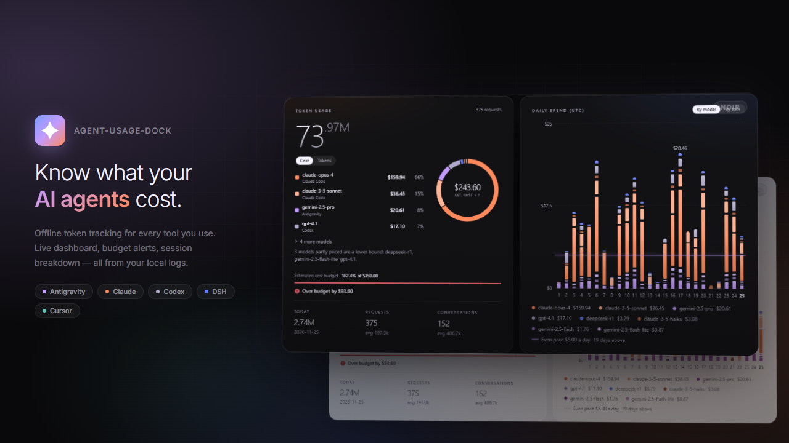
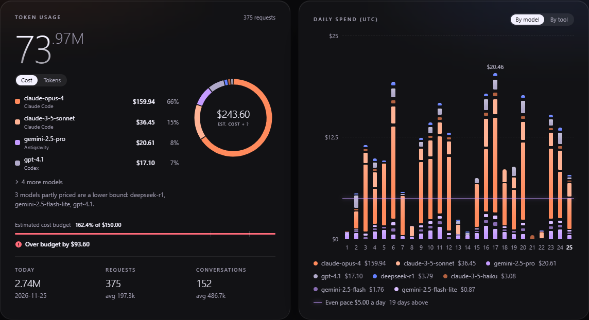
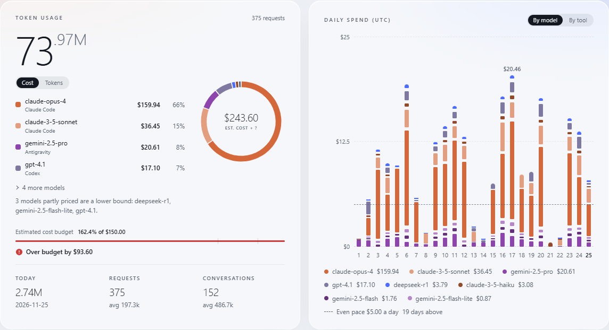
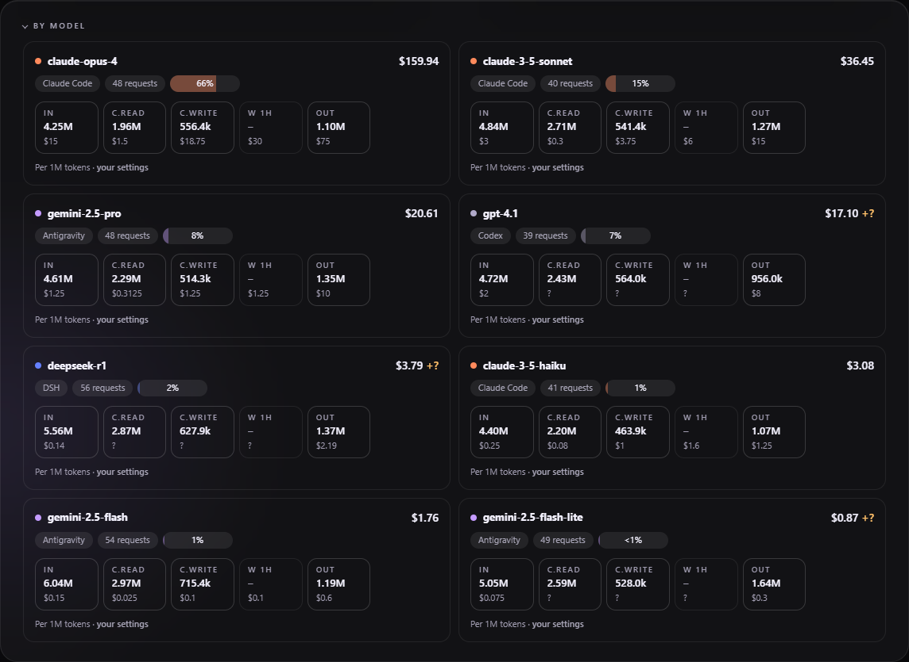
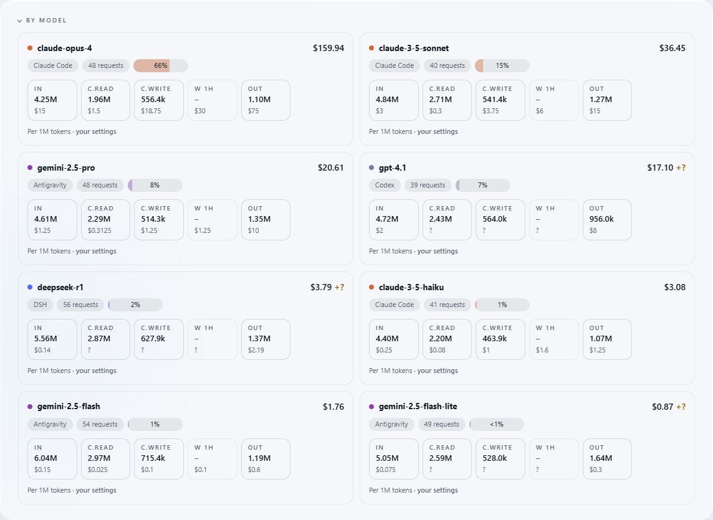

<div align="center">

# agent-usage-dock

An offline usage dock for your AI agents.<br>
A VS Code and Antigravity extension, with a CLI companion, for tracking local token usage, estimated costs, and shared monthly budgets.


<br>



</div>

- **Local & unified**: Reads logs from **Antigravity**, **DSH**, **Claude Code**, and **Codex**, and imports **Cursor** ledgers into one shared store (`~/.agy-token-tracker`).
- **Status bar & dashboard**: Live today/month totals, optional token or cost budgets with warning/critical indicators, hover chart, daily bars, model breakdown, session inspector, and CSV export.
- **Private by design**: Zero network requests, zero telemetry, no credentials or chat prompts in the accounting ledger. Explicit offline HTML exports include first-prompt summaries. Accounting days and billing months use UTC; session views support `UTC` or `SGT`.

<details>
<summary><strong>Dashboard screenshots</strong></summary>

| Dark (Noir) | Light (Mist) |
|:-:|:-:|
|  |  |
|  |  |

</details>

## Install & Build

Requires **VS Code 1.85+** and **Node 18+** at runtime (**Node 22+** to package the VSIX).

- **DSH logs** (zstd-compressed) require native zstd support in the active runtime (**Node 22.15+** or **23.8+**).
- **Antigravity databases** use `node:sqlite` when available, or `sqlite3` on `PATH` (overridable via `AGY_SQLITE3`).

```sh
npm ci
npm run check && npm test
npm run package
code --install-extension "agent-usage-dock-$(node -p 'require("./package.json").version').vsix" --force
```

In Antigravity, install via **Extensions: Install from VSIX**.

## Data Sources

Each source resolves its root from `agyTokenTracker.*` settings first, then its environment variable, then its default path (`~` is expanded).

| Source | Log files read | Setting | Env var | Default root |
|---|---|---|---|---|
| **Antigravity** | `brain/<id>/.system_generated/logs/transcript.jsonl`, `conversations/<id>.db`, `conversation_summaries.db` | `antigravityHome` | `ANTIGRAVITY_HOME` | `~/.gemini/antigravity` |
| **DSH** | `sessions/**/session.v4.jsonl.zstd` | `dshHome` | `DSH_HOME` | `~/.dsh` |
| **Claude Code** | `projects/**/*.jsonl` | `claudeHome` | `CLAUDE_CONFIG_DIR` | `~/.claude` |
| **Codex** | `sessions/**/*.jsonl`, `archived_sessions/**/*.jsonl` | `codexHome` | `CODEX_HOME` | `~/.codex` |

- **Cursor**: Cursor stores no local usage logs. Import snapshots from `cursor-usage-monitor` via the CLI (`import ~/.cursor-usage-monitor/usage.json`). Model effort/thinking suffixes are normalized for display and pricing while preserving raw names in the ledger.
- **Health states**: Sources report **Ready**, **Incomplete** (partial read or skipped lines; prior usage retained), **Not installed** (missing default root), or **Disabled** (switched off via `*Enabled`, retaining existing history). Explicit custom paths that do not exist report **Incomplete**.
- **DSH links**: Symlinked folders and logs are followed only within the real `sessions/` root and collected once. Links outside that root, dangling links, loops and permission failures report **Incomplete** and make CLI `flush` exit `1`. Discovery always selects the highest log generation, including through aliases.

## Commands & Settings

Open the Command Palette (`agent-usage-dock:`):

- **Refresh Now** — Scan local logs immediately.
- **Open Dashboard** — View monthly/daily charts, model cards, sessions, and collection status.
- **Set Monthly Budget** — Set `tokenBudgetLimit` (M tokens) or `budgetLimit` (USD); `0` disables indicators.
- **Configure Rates** — Override per-million-token USD rates for models seen in the current view.
- **Export CSV** — Save daily usage (`day,source,model,requests,input,cache_read,cache_write,cache_write_1h,output,estimated_usd,provider,tier,estimate_note`).
- **Export Offline HTML** — Save a self-contained `.html` snapshot (`agent-usage-dock-YYYY-MM-DD.html`) for offline viewing in any JavaScript-capable browser (`file://`, no VS Code/Node/network required).
  - Includes all retained historical months, sessions, collection status, custom rates, budgets, `correctionFactor`, and session metadata/first-prompt summaries.
  - Static point-in-time snapshot (not encrypted): re-export after new usage; viewing on another device does not merge usage across machines; store privately. Some mobile file previewers disable JavaScript—open in a standard browser instead.
- **Rebuild History** — Back up the ledger, rescan logs on disk, and merge with the durable archive.

### Configuration (`agyTokenTracker.*`)

Collection roots and `*Enabled` switches are machine-scoped (user settings only). Legacy `agyTokenMonitor.*` settings, command IDs, and `AGY_TOKEN_MONITOR_HOME` remain supported as fallbacks.

| Setting | Default | Description |
|---|---|---|
| `antigravityEnabled`, `dshEnabled`, `claudeEnabled`, `codexEnabled` | `true` | Enable or pause each collector without deleting stored history |
| `antigravityHome`, `dshHome`, `claudeHome`, `codexHome` | `""` | Custom root directory for each tool |
| `budgetMode` | `"tokens"` | Monthly budget metric: `"tokens"` or `"cost"` |
| `tokenBudgetLimit` / `budgetLimit` | `0` | Monthly cap in millions of tokens / USD (`0` disables) |
| `warningThreshold` / `criticalThreshold` | `0.75` / `0.9` | Budget fractions (`0`–`1`) for amber and red status indicators |
| `pollIntervalSeconds` | `60` | Background scan interval (`15`–`86400` seconds) |
| `rates` | `{}` | USD per 1M tokens keyed by `model`, `source/model`, or `source[provider]/model` (wildcards `*` supported; up to 1,000 entries and 256 characters per key) |
| `correctionFactor` | `1` | Global multiplier applied to estimated costs |
| `dashboardTheme` | `"light"` | `"light"`, `"dark"`, or `"auto"` |
| `timeZone` | `"SGT"` | Session display timezone: `"UTC"` or `"SGT"` |
| `statusBarStyle` | `"percent"` | `"percent"`, `"gauge"`, or `"ring"` |
| `levelIndicator` | `"bar"` | `"bar"` or `"ring"` |
| `tooltipChart` | `true` | Render the daily chart image in the status bar hover |

## CLI

The extension installs `cli.js` (and `dshWorker-<version>.js`) into `~/.agy-token-tracker` (overridable via `AGY_TOKEN_TRACKER_HOME`). The CLI reads flags and environment variables rather than editor settings.

```sh
node ~/.agy-token-tracker/cli.js flush [--source antigravity|dsh|claude|codex|all] \
                                       [--home PATH] [--dsh-home PATH] [--claude-home PATH] [--codex-home PATH]
node ~/.agy-token-tracker/cli.js import <path-to-store.json>
node ~/.agy-token-tracker/cli.js --help
```

- `flush` strictly validates complete records (default `--source antigravity`) and exits `1` on any unreadable line, incomplete collection, or lock timeout—making it safe to gate log cleanup scripts (such as `clear-ai-history`).
- `import` merges another v1–v3 ledger or `cursor-usage-monitor` `usage.json` into the shared store.
- Exit codes: `0` success, `1` collection/store/lock failure, `2` invalid arguments.

## Pricing, Privacy & Storage

- **Estimates, not invoices**: Built-in reference tables price Claude, OpenAI/Codex, Gemini, Cursor, and DeepSeek models at current rates (DSH official routes apply half-price off-peak tiers outside UTC weekdays `01:00–04:00` and `06:00–10:00`, excluding holidays). Models without a price remain visible with their token counts and are flagged as unpriced.
- **Privacy**: The ledger records token counts, UTC timestamps, model/route names, session IDs, the final folder name of the working directory, Antigravity/DSH titles, plus scanned log paths and error diagnostics. Prompts, chat text, tool output, and credentials are never stored; Claude Code and Codex session titles/first prompts are read on demand when opening a session detail popup.
- **Storage layout (`~/.agy-token-tracker/`)**:
  - `usage-v3.json` — Active request ledger, summaries, file cursors, and source health (migrated automatically from v1/v2 stores on first run).
  - `archive/history-ledger-v3.json` — Durable append/union snapshot written alongside the working store under an atomic `usage-v3.json.lock/` directory lock.
  - `backups/` — Daily UTC snapshots (7 retained) and pre-rebuild backups (5 retained).

### Recovering a damaged archive

Damaged archives are never overwritten or moved automatically. To recover:

1. Close all editor windows and stop any running CLI processes.
2. Back up the entire `~/.agy-token-tracker` folder.
3. Move the damaged `archive/history-ledger-v3.json` aside (do not delete it yet).
4. Restore a known-good snapshot from `backups/` to `usage-v3.json`.
5. Reopen the editor or run `cli.js flush` to regenerate the archive from the restored store and remaining logs.

## Development

Ledger loading, collection, reconciliation and JSON writes run in a persistent worker; only summaries and file cursors return to the extension host. JSONL cursor versions invalidate old parser results on upgrade.

```sh
npm run check       # Type-check sources and tests (tsconfig.test.json)
npm test            # Hermetic tests; builds its offline fixture from source, no dist/ needed
npm run build       # Bundle extension, CLI, and DSH worker into dist/
npm run watch       # Incremental esbuild with source maps
npm run smoke       # Run bundled CLI in a clean sandbox
npm run benchmark   # After npm test: synthetic JSONL/ledger/export timings and I/O counts
npm run check:vsix  # Verify VSIX contents, manifest, bundles, and README parity
npm run clean       # Remove out/ and dist/
```

- Dashboard keyboard/CSP browser smoke check (after `npm test`): `uv run --no-project --with playwright==1.60.0 python -B tools/browser_test_dashboard.py`
- Pass `npm test -- --max-skipped 0` to require every test to run.
- Where browser policy blocks `file://`, set `AGY_TEST_OFFLINE_HTTP=1` for the browser check to load the same offline HTML through loopback HTTP. This does not validate `file://` support.
- Optional icon font regeneration: `uv run --no-project --with fonttools python -I tools/build-icon-font.py`
- `package.json` packages `README.md` verbatim (`--no-rewrite-relative-links`), so keep links absolute or text-only.

## License

GNU General Public License v3.0 (GPL-3.0) — see [LICENSE](LICENSE).
